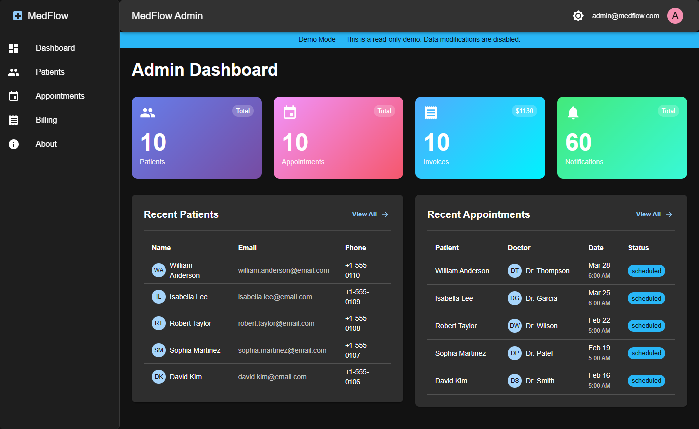

# MedFlow

**Production-grade polyglot microservices for healthcare, built with .NET 10, Node.js 22, and a full observability stack.**

A distributed system reference architecture demonstrating enterprise microservices patterns: event-driven communication via MassTransit/RabbitMQ, Saga orchestration, circuit breakers with Polly, Consul service discovery, polyglot persistence (SQL Server + MongoDB), and end-to-end observability with Serilog, Prometheus, Grafana, Jaeger, and Seq.

Built entirely through AI-assisted pair programming.

**Live demo:** [medflow.al-ex.ai](https://medflow.al-ex.ai) (demo users are listed on the sign-in page)



---

## Architecture Overview

```
┌─────────────────────────────────────────────────────────┐
│                    React 19 + MUI 7                     │
│                   (Vite + TypeScript)                   │
└────────────────────────┬────────────────────────────────┘
                         │
┌────────────────────────▼────────────────────────────────┐
│               YARP Reverse Proxy Gateway                │
│           Health Checks UI · Rate Limiting              │
└───┬──────────┬──────────────┬───────────────┬───────────┘
    │          │              │               │
┌───▼───┐ ┌───▼────┐  ┌──────▼──┐  ┌─────────▼──┐
│Patient│ │Appoint-│  │Billing  │  │Notification│
│.NET 10│ │ment    │  │.NET 10  │  │.NET 10     │
│       │ │Node.js │  │         │  │            │
└───┬───┘ └───┬────┘  └────┬────┘  └─────┬──────┘
    │         │            │             │
    └─────────┴──────┬─────┴─────────────┘
                     │
┌────────────────────▼────────────────────────────────────┐
│                    RabbitMQ (MassTransit)                │
│              Event Bus · Saga Orchestration              │
└─────────────────────────────────────────────────────────┘
         │              │               │
    ┌────▼────┐   ┌─────▼─────┐  ┌──────▼──────┐
    │SQL      │   │MongoDB 7  │  │Redis 7      │
    │Server   │   │           │  │             │
    │2022     │   │           │  │             │
    └─────────┘   └───────────┘  └─────────────┘

┌─────────────────────────────────────────────────────────┐
│                 Observability Stack                      │
│  Seq (Logs) · Prometheus (Metrics) · Grafana (Dash)     │
│  Jaeger (Traces) · Consul (Discovery) · Health UI       │
└─────────────────────────────────────────────────────────┘
```

## Microservices

| Service | Runtime | Database | Cache | Key Packages |
|---------|---------|----------|-------|--------------|
| **Patient Service** | .NET 10 | SQL Server | Redis | EF Core, MassTransit, Polly, Serilog, OpenTelemetry, Consul |
| **Appointment Service** | Node.js 22 | MongoDB | Redis | Express, Mongoose, amqplib, Winston, OpenTelemetry, prom-client |
| **Billing Service** | .NET 10 | SQL Server | Redis | EF Core, MassTransit, Polly, Serilog, OpenTelemetry |
| **Notification Service** | .NET 10 | MongoDB | None | MongoDB.Driver, MassTransit, Serilog, OpenTelemetry |

## Infrastructure

| Component | Technology | Purpose |
|-----------|-----------|---------|
| **API Gateway** | YARP 2.3 | Reverse proxy, routing, health aggregation |
| **Service Discovery** | Consul | Dynamic service registration and health-check-driven routing |
| **Message Broker** | RabbitMQ 3 | Event-driven communication with MassTransit (Saga, retry, outbox) |
| **Cache** | Redis 7 | Distributed caching with `StackExchange.Redis` |
| **Relational DB** | SQL Server 2022 | ACID transactions for Patient and Billing domains |
| **Document DB** | MongoDB 7 | Flexible schema for Appointments and Notifications |

## Observability Stack

| Tool | Purpose | URL |
|------|---------|-----|
| **Seq** | Centralized structured logging (Serilog sink) | `http://localhost:5341` |
| **Prometheus** | Metrics collection and alerting | `http://localhost:9090` |
| **Grafana** | Dashboards and metric visualization | `http://localhost:3001` |
| **Jaeger** | Distributed tracing (OpenTelemetry OTLP) | `http://localhost:16686` |
| **Health Checks UI** | Aggregated health status for all services | `http://localhost:5100/healthchecks-ui` |
| **RabbitMQ Management** | Queue monitoring and management | `http://localhost:15672` |
| **Consul UI** | Service discovery and health | `http://localhost:8500` |
| **Redis Commander** | Cache data browser | `http://localhost:8081` |
| **Mongo Express** | MongoDB data browser | `http://localhost:8082` |

## Enterprise Patterns

| Pattern | Implementation |
|---------|---------------|
| **Event-Driven Architecture** | MassTransit publish/subscribe over RabbitMQ |
| **Saga Orchestration** | Cross-service workflow coordination (Patient → Appointment → Billing → Notification) |
| **Circuit Breaker** | Polly (.NET): prevent cascade failures across service boundaries |
| **CQRS** | Separate command and query pipelines |
| **Service Discovery** | Consul with dynamic registration and health checks |
| **API Gateway** | YARP reverse proxy with per-cluster routing |
| **Distributed Tracing** | OpenTelemetry → Jaeger (OTLP) across all services |
| **Distributed Caching** | Redis with cache-aside pattern |
| **Polyglot Persistence** | SQL Server for relational, MongoDB for documents |
| **Health Checks** | AspNetCore.HealthChecks with aggregated UI |
| **Structured Logging** | Serilog → Seq with correlation IDs |
| **Schema Registry** | Shared JSON Schema contracts for cross-language event validation |

## Event Flow

```
Patient Created → AppointmentService (sync availability)
                → NotificationService (welcome email)

Appointment Created → BillingService (generate invoice)
                    → NotificationService (confirmation)

Invoice Created → NotificationService (payment reminder)
```

Event schemas are defined in [`schemas/`](schemas/) as JSON Schema, enabling independent service development across .NET and Node.js without shared code dependencies.

## Frontend

React 19 dashboard built with:
- **MUI 7** (Material UI) with Emotion styling
- **React Router 7** for navigation
- **Axios** for API calls
- **Vite 8** + TypeScript for build tooling
- **Nginx** for production serving (Docker)

## Project Structure

```
MedFlow/
├── src/
│   ├── ApiGateway/              # YARP reverse proxy (.NET 10)
│   └── Services/
│       ├── PatientService/      # .NET 10 + SQL Server + Redis
│       ├── AppointmentService/  # Node.js 22 + MongoDB + Redis
│       ├── BillingService/      # .NET 10 + SQL Server + Redis
│       └── NotificationService/ # .NET 10 + MongoDB
├── frontend/                    # React 19 + MUI 7 dashboard
├── infrastructure/
│   ├── grafana/                 # Datasource provisioning
│   ├── prometheus/              # Scrape configs (local + Docker)
│   ├── mongodb/                 # Init scripts
│   └── sql/                     # Database init scripts
├── schemas/                     # JSON Schema event contracts
├── docs/                        # Architecture documentation
├── docker-compose.yml           # Infrastructure (DBs, messaging, monitoring)
├── docker-compose.services.yml  # Application services + frontend
└── docker-compose.debug.yml     # Debug configuration
```

## Quick Start

### Prerequisites

- Docker Desktop
- .NET 10 SDK
- Node.js 22 LTS

### Run Everything

```bash
# Start infrastructure (databases, messaging, monitoring)
docker-compose up -d

# Start all services + frontend
docker-compose -f docker-compose.yml -f docker-compose.services.yml up -d

# View logs
docker-compose -f docker-compose.yml -f docker-compose.services.yml logs -f

# Stop everything
docker-compose -f docker-compose.yml -f docker-compose.services.yml down
```

### Run Infrastructure Only (for local development)

```bash
# Start databases, RabbitMQ, Redis, Consul, monitoring
docker-compose up -d

# Run individual services locally
cd src/Services/PatientService/PatientService.API && dotnet run
cd src/Services/AppointmentService && npm run dev
cd src/Services/BillingService/BillingService.API && dotnet run
cd src/Services/NotificationService/NotificationService.API && dotnet run
```

## Service Endpoints

| Service | Local Dev | Docker |
|---------|-----------|--------|
| API Gateway | `http://localhost:5000` | `http://localhost:5100` |
| Patient Service | `http://localhost:5001` | `http://localhost:5125` |
| Appointment Service | `http://localhost:5002` | `http://localhost:5126` |
| Billing Service | `http://localhost:5003` | `http://localhost:5156` |
| Notification Service | `http://localhost:5004` | `http://localhost:5160` |
| Frontend | `http://localhost:5173` | `http://localhost:5180` |

## Technology Stack

| Category | Technologies |
|----------|-------------|
| **Backend** | .NET 10, C# 14, Node.js 22, Express 5 |
| **Frontend** | React 19, TypeScript 5.9, MUI 7, Vite 8 |
| **Databases** | SQL Server 2022, MongoDB 7 |
| **Messaging** | RabbitMQ 3, MassTransit 8 |
| **Caching** | Redis 7 |
| **Gateway** | YARP 2.3 |
| **Discovery** | Consul |
| **ORM/ODM** | EF Core 10, Mongoose 9, MongoDB.Driver 3 |
| **Resilience** | Polly 8 |
| **Logging** | Serilog 10, Winston 3, Seq |
| **Metrics** | prometheus-net, prom-client, Prometheus, Grafana |
| **Tracing** | OpenTelemetry 1.17, Jaeger |
| **Health** | AspNetCore.HealthChecks 9 |
| **Containers** | Docker, Docker Compose |

## Development Phases

- **Phase 1**: Core services (Patient, Appointment) + infrastructure + monitoring stack
- **Phase 2**: Billing, Notification services + Saga orchestration + circuit breakers
- **Phase 3**: Authentication, authorization + React dashboard

## Documentation

- [Event Schemas](schemas/README.md)
- [Monitoring URLs](docs/MONITORING_URLS.md)

## License

MIT. See [LICENSE](LICENSE).

## Author

Alex Husniddinov
